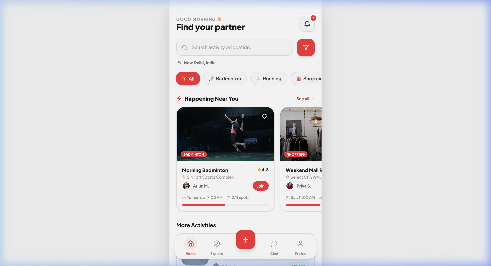
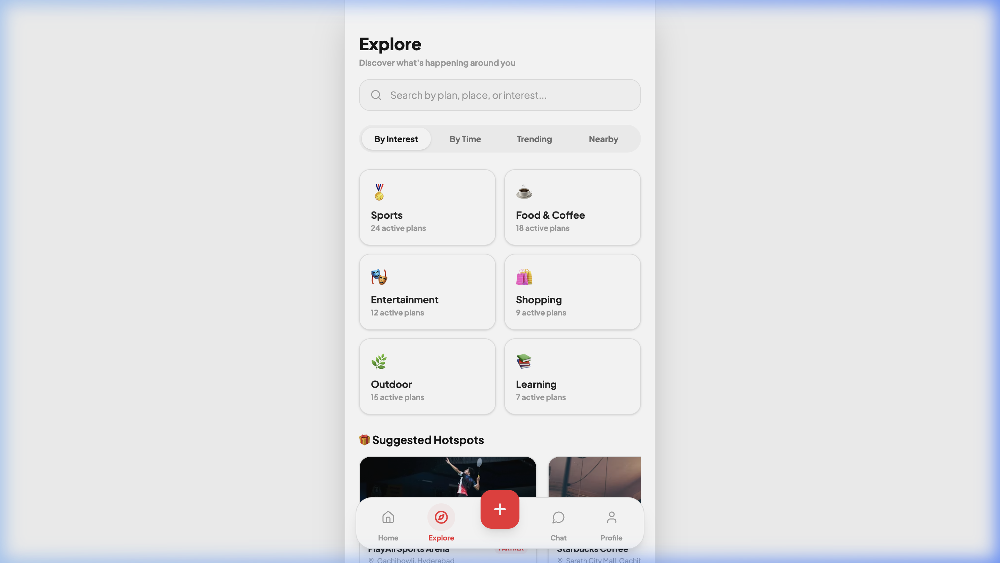
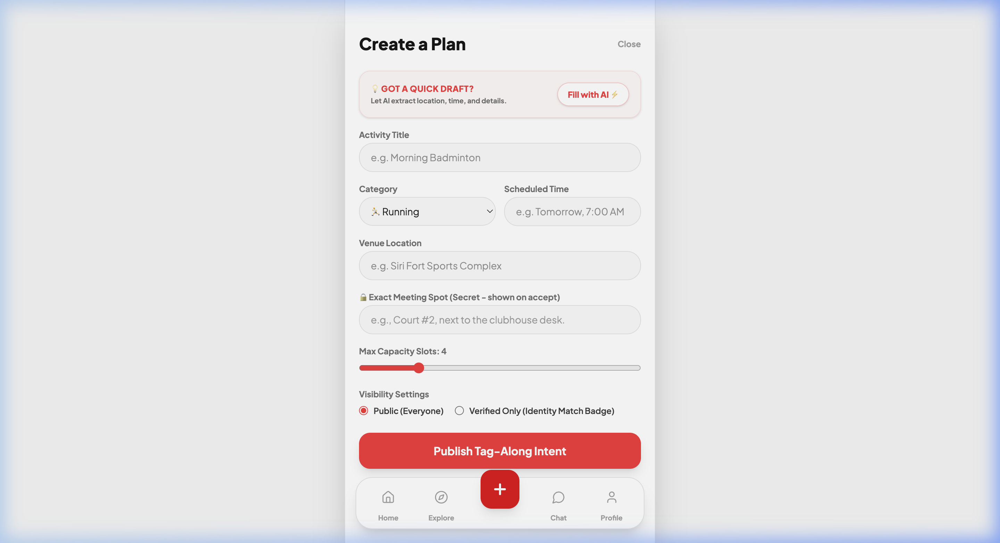
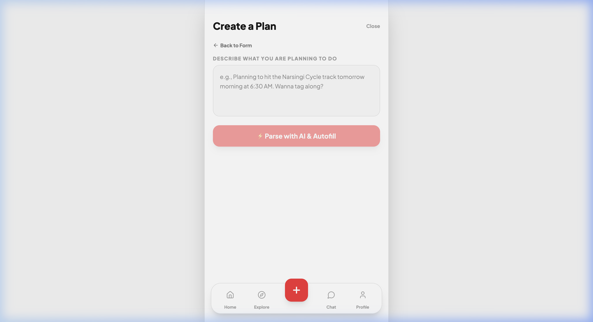
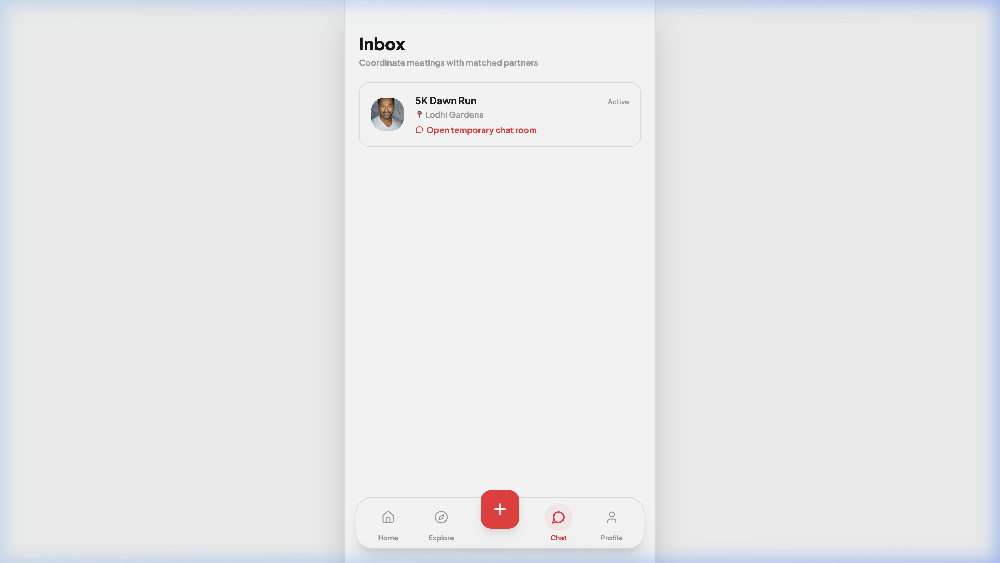
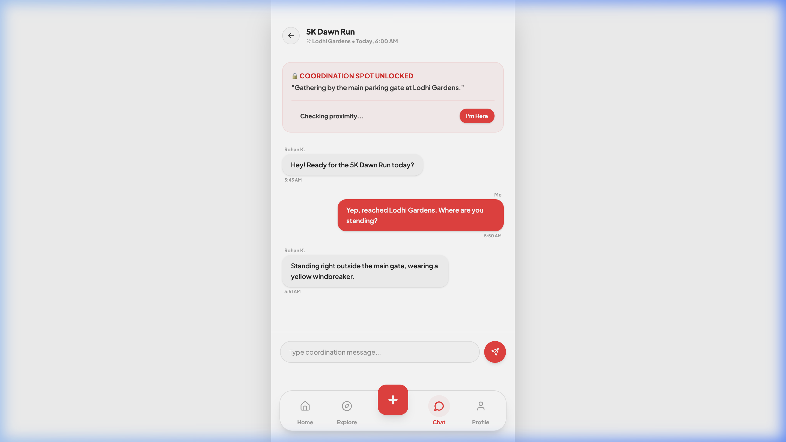
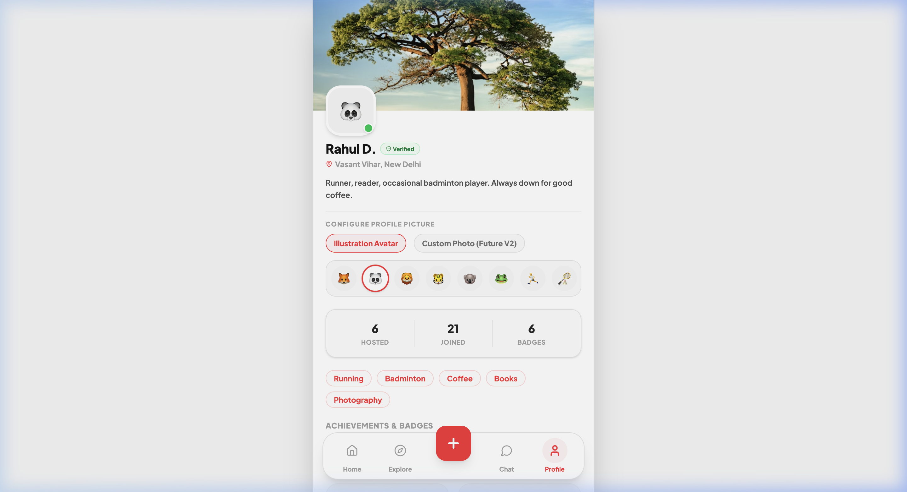

# Along

> Find people for your next plan.

---

## 1. What is Along?

Along is a platonic, action-oriented social planning utility built around the **"Tag-Along"** philosophy:

> **"I am doing X, at time Y, at venue Z. Who wants to tag along?"**

Instead of scrolling through digital content feeds or managing large community lists, Along is designed to help users quickly post their daily intentions (e.g. coffee runs, cycle track rounds, Zara shopping) and find local companions to join them in person.

---

## 2. Directory Index & Project Structure

The Along repository contains the following core files and directories:

* **[docs/00_User_Flows_And_Features.md](file:///Users/gopalchoudhary/Desktop/codes/Along/docs/00_User_Flows_And_Features.md)**: Details the end-to-end Tag-Along lifecycle (Intents Posting $\rightarrow$ Requests Vetting $\rightarrow$ Coordination Chat $\rightarrow$ Proximity GPS Check-in) and tab navigation lists.
* **[docs/01_UI_UX_Design.md](file:///Users/gopalchoudhary/Desktop/codes/Along/docs/01_UI_UX_Design.md)**: Declares design style guidelines, typography rules, color tokens, and links to the live interactive Figma designs.
* **[docs/02_Tech_Stack_Research.md](file:///Users/gopalchoudhary/Desktop/codes/Along/docs/02_Tech_Stack_Research.md)**: Mobile-first React Native + Expo & Supabase technical architectural stack breakdown.
* **[prototype/](file:///Users/gopalchoudhary/Desktop/codes/Along/prototype/)**: A Vite + React + Tailwind CSS v4 prototype. It has a fully mockable dashboard in [App.tsx](file:///Users/gopalchoudhary/Desktop/codes/Along/prototype/src/app/App.tsx) simulating OTP auth, category filters, AI NLP text description parsing, group chat coordination, and check-ins.
* **[assets/](file:///Users/gopalchoudhary/Desktop/codes/Along/assets/)**: Houses screenshots of the actual running local prototype screens.

---

## 3. UI Prototype Visual Catalog (Screenshots)

### 🏠 Tab 1: Home Dashboard
The landing feed displaying category filters, online neighbors ("Active Nearby"), and local tag-along cards.


***

### 🔍 Tab 2: Explore Discovery
Discovery grid with category counts and sponsored café/venue suggestion cards.


***

### ➕ Tab 3: Create Plan Studio
* **Primary Form**: Manual entry details form presented by default.
* **AI Autofill [Secondary]**: Optional prompt text-area overlay to parse custom descriptions.

| Primary Intent Form | Secondary AI Autofill |
| :---: | :---: |
|  |  |

***

### 💬 Tab 4: Chat & Coordination
* **Chat Inbox**: Lists all plans you have joined.
* **Chat Room**: Access to the plan chat log, locked coordination secrets box, and GPS proximity check-in.

| Chat Inbox List | Chat Room Conversation |
| :---: | :---: |
|  |  |

***

### 👤 Tab 5: Profile Passport
Displays user verification check, stats (Hosted/Joined), interests, and badges grid.


---

## 4. How to Run the Prototype Locally

To run the interactive prototype:
1. Navigate into the prototype directory:
   ```bash
   cd prototype
   ```
2. Install npm packages:
   ```bash
   npm install
   ```
3. Start the local server:
   ```bash
   npm run dev
   ```
4. Open [http://localhost:5173/](http://localhost:5173/) in your web browser.
