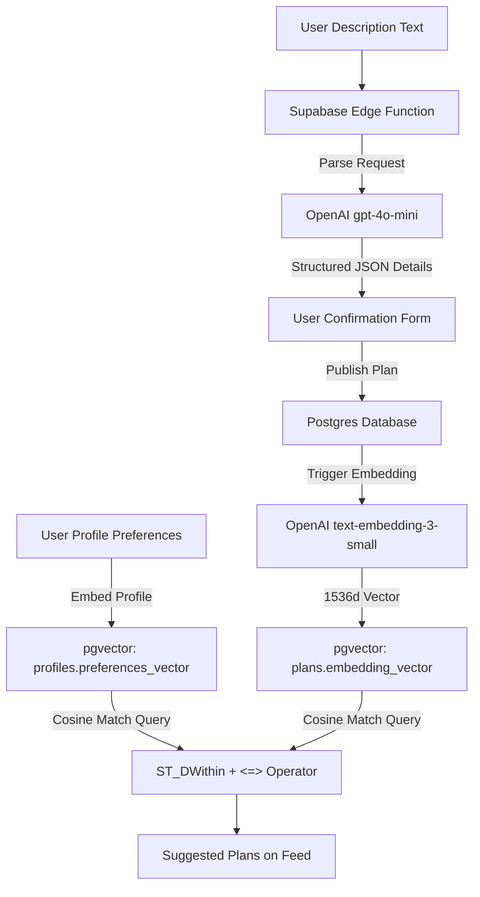
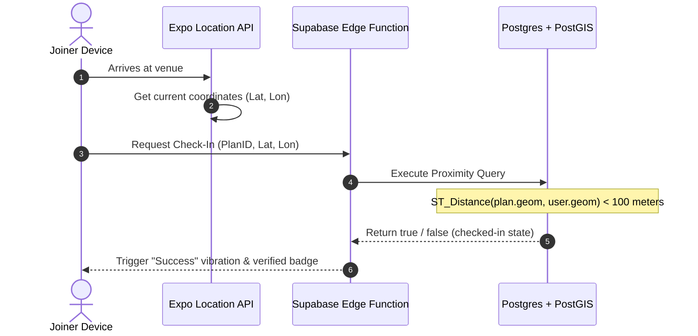

# Along - Tech Stack Deep-Dive Research

This document provides a detailed comparative analysis of different mobile-first framework combinations, backend architectures, geospatial databases, chat solutions, and AI & Maps search engine choices for Along.

---


## 1. Mobile Frameworks Comparison (Client)

| Feature / Metric | React Native (Expo Go) | Flutter (Dart) | Kotlin Multiplatform (KMP) |
| :--- | :--- | :--- | :--- |
| **Language & Learning Curve** | **JavaScript / TypeScript (Low)**: Reuses React skills. | **Dart (Medium)**: Object-oriented, separate ecosystem. | **Kotlin / Swift (High)**: Requires knowing native constructs. |
| **UI Performance** | **High**: Uses JSI (JavaScript Interface) and Fabric compiler. | **Ultra-High**: Direct Skia/Impeller hardware compilation. | **Maximum**: Compiles to 100% native UI widgets. |
| **Code Reuse** | High (can share models, hooks, and styles with Web Vite app). | Medium (cross-platform mobile, separate from standard web HTML). | Medium (shares logic; UI is usually written separately). |
| **OTA Updates** | **Yes (Expo Updates)**: Bypass store reviews. | No (requires complex third-party tools). | No (compiled binary updates only). |
| **Native APIs Access** | **Excellent (Expo SDK)**: Plug-and-play location, notifications. | Excellent (Flutter Plugins). | High (requires writing manual platform channels). |

---

## 2. Backend & Database Comparison

| Feature / Metric | Supabase (Postgres) | Firebase (Firestore) | Custom Server (Node.js/FastAPI + Postgres) |
| :--- | :--- | :--- | :--- |
| **Database Paradigm** | **Relational (PostgreSQL)**: Strong schema, easy joins. | **NoSQL Document Database**: Hard to join collections. | **Relational / NoSQL**: Flexible configuration. |
| **Geospatial Queries** | **Excellent (PostGIS)**: Runs native radius, distance checks. | **Poor**: No spatial indexes; requires client-side geohashing. | **Excellent (PostGIS)**: Full custom SQL queries. |
| **Real-time Capabilities** | **Yes**: Websockets synced to database table updates. | **Yes**: Firestore listeners. | **Yes**: Requires managing manual Socket.io servers. |
| **Authentication** | **Built-in**: Phone OTP, Google/Apple, Row-Level Security (RLS). | **Built-in**: Phone OTP, Google/Apple. | **Manual**: Must write JWT, session storage, and security logic. |
| **Hosting & Dev Ops** | **Serverless**: Zero configuration needed. | **Serverless**: Zero configuration needed. | **Self-Hosted**: Requires EC2/Heroku setup, SSL, backups. |

---

## 3. AI Pipeline & Semantic Matchmaking Architecture



### A. NLP Parsing Integration
* **Model**: `gpt-4o-mini`
* **Workflow**:
  1. The user inputs their plan draft.
  2. The frontend sends it to `/api/v1/plans/parse-nlp`.
  3. The endpoint instructs the LLM with a system prompt and a schema tool definition:
     ```json
     {
       "name": "extract_plan",
       "parameters": {
         "type": "object",
         "properties": {
           "title": { "type": "string" },
           "category": { "type": "string", "enum": ["sports", "running", "shopping", "yoga", "cycling", "hiking"] },
           "datetime": { "type": "string" },
           "venue_name": { "type": "string" }
         },
         "required": ["title", "category", "datetime", "venue_name"]
       }
     }
     ```
  4. The returned structured properties populate the React Native details state immediately.

### B. pgvector Matchmaking Engine
Along represents user profiles and plans as vectors to suggest plans matching user interests:
* User profile vector represents their historically completed activity types and self-declared tags.
* Plan vector represents category, title description, and vibe tags.
* Similarity ranking uses the cosine distance operator `<=>` (where `0` is identical, `1` is orthogonal):
  ```sql
  SELECT id, title, category, (embedding_vector <=> $1) as distance
  FROM plans
  WHERE status = 'active'
  ORDER BY distance ASC
  LIMIT 5;
  ```

---

## 4. Maps & Search Autocomplete Engine

### A. Place Search Autocomplete (Google Places API v1)
We use the Google Places API (New) for location search input:
* **Session Tokens**: Every place autocomplete search uses a unique UUID session token. Keystroke inputs are compiled under a single session billing unit.
* **Geocoding**: Once the user selects a place from autocomplete, we request the details (Latitude, Longitude, and formatted address) using the Place ID.
* **Database Storage**: Coordinates are saved in Postgres using the PostGIS spatial type:
  ```sql
  ALTER TABLE plans ADD COLUMN geom geography(Point, 4326);
  -- Insert statement:
  INSERT INTO plans (geom) VALUES (ST_SetSRID(ST_MakePoint(longitude, latitude), 4326)::geography);
  ```

### B. Proximity Maps (React Native Maps + styled tiles)
* **Parity**: We enforce Google Maps SDK on both iOS and Android to prevent visual inconsistencies.
* **Privacy Proximity Mask**: The coordinates pinned on the Explore map use a randomized offset (200m radius circle) to mask the host's actual coordinates before acceptance.
  ```typescript
  // Simple proximity obfuscation for public maps views
  const randomOffset = () => (Math.random() - 0.5) * 0.003; // ~150-200m offset
  const displayLat = exactLat + randomOffset();
  const displayLng = exactLng + randomOffset();
  ```

---

## 5. Location Proximity & GPS Check-In Architecture



1. **Expo Location SDK**: Sets a background location task on the phone that wakes up when the user crosses a geofence (within 200m of the venue).
2. **Proximity Check**: Once within 100 meters, the app prompts a "Check-In" button.
3. **Database Assertion**: The server calculates the mathematical distance using PostGIS geography points to verify the user did not spoof their GPS coordinates on the client.
