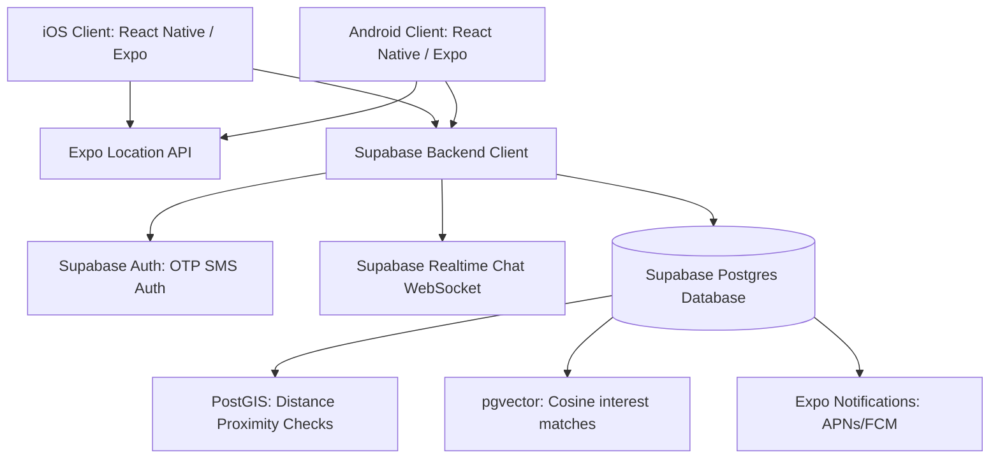

# Along - Tech Stack Research

This document outlines the mobile-first engineering stack for Along, optimized for cross-platform (iOS and Android) performance, geospatial queries, and real-time coordination.

---

## 👥 Task Debate Transcript (Custom Workflow)

> 👤 **Product Manager (PM)**: 
> "Our focus is platonic, action-oriented tag-along plans. The app must run natively on iOS and Android because users coordinate on-the-go (running tracks, shopping malls). We need reliable push notifications (cancellations/joins) and immediate map coordinate visualizers. A web app is not enough; we need background location access to trigger check-ins."
> 
> 💻 **Senior Software Engineer (SE)**: 
> "For cross-platform development, I recommend **React Native + Expo**. This lets us leverage our existing React codebase and types, while maintaining near-native performance. For the backend, **Supabase (PostgreSQL)** is the clear winner over Firebase. It natively supports the **PostGIS extension** for low-latency bounding box radius queries, and **pgvector** for our AI interest embedding cosine searches. Real-time websockets (Supabase Realtime) are built-in for our ephemeral chats."
> 
> 🎨 **UI/UX Engineer**: 
> "Agreed. Using React Native allows us to use **NativeWind (Tailwind CSS v4 for React Native)**, which ensures our color systems (HSL slate/coral), squircle buttons, Outfit/Inter typography, and glassmorphic modal styles map perfectly to our Figma specs on both iOS and Android viewports."
> 
> 🚀 **Entrepreneur (Founder)**: 
> "React Native + Expo dramatically shortens our time-to-market. We can use Expo Go to share live builds instantly with users, and Supabase's generous serverless database free tier keeps our operational costs at zero during Phase 1 (growth phase). Let's go with this stack."

### Consensus Recommendation
* **Frontend**: React Native + Expo (TypeScript).
* **Styling**: NativeWind (Tailwind CSS v4).
* **Database & Auth**: Supabase PostgreSQL + PostGIS (geospatial) + pgvector (AI match).
* **Notifications**: FCM (Android) + APNs (iOS) via Expo Notifications.

---

## 1. Selected Tech Stack Architecture

---

## 2. Technical Stack Breakdown

### A. Mobile Frontend (Cross-Platform)
* **Framework**: **React Native with Expo SDK**.
  - *Why*: Compiles to native iOS and Android views. Expo provides robust modules for native features like camera verification, background location tracker, and push notifications without needing complex native Java/Objective-C configurations.
* **Navigation**: **React Navigation / Expo Router** (file-based navigation matching Next.js).
* **Map Engine**: **React Native Maps** (Google Maps on Android, Apple Maps/Google Maps on iOS).

### B. Proximity & Location Checking
* **Client side**: **Expo Location API** to request device GPS positions and verify proximity.
* **Server side**: **PostGIS extension** inside PostgreSQL.
  - *Why*: Allows us to store geo-points directly as `geography(Point, 4326)` and run queries like `ST_DWithin` to find plans in a 2km bounding box in under 10ms.

### C. Backend-as-a-Service (BaaS)
* **Platform**: **Supabase**.
  - *Auth*: Passwordless OTP SMS authentication (connected to Twilio).
  - *Real-time messaging*: Supabase Realtime engine (utilizing WebSockets to sync messages instantly in ephemeral chats).
  - *Storage*: Supabase Storage buckets to store user verification photos and cover banners.

### D. AI Matchmaking & Moderation
* **Embeddings Database**: PostgreSQL **pgvector extension** to calculate vector similarity for interest tagging.
* **Serverless Functions**: **Supabase Edge Functions** (Deno-based serverless typescript endpoints) for running text-embedding queries and Perspective API toxicity checks during plan creation.
