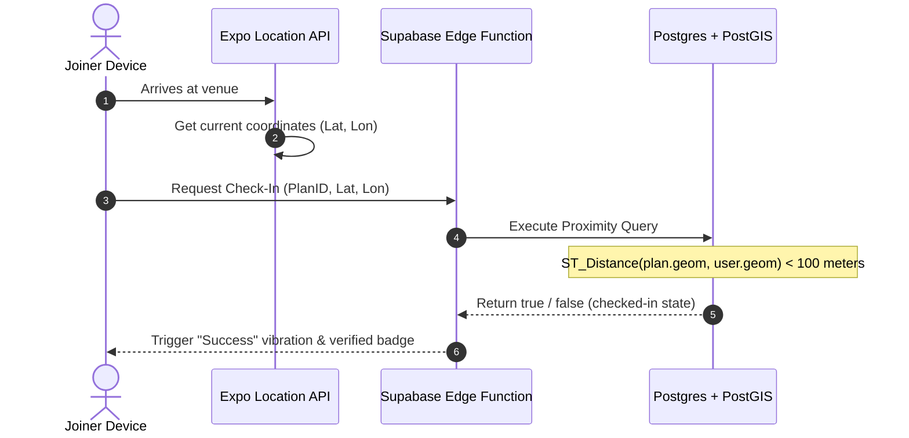

# Along - Tech Stack Deep-Dive Research

This document provides a detailed comparative analysis of different mobile-first framework combinations, backend architectures, geospatial databases, and chat solutions for Along.

---

## 👥 Task Debate Transcript (Custom Workflow)

> 👤 **Product Manager (PM)**: 
> "Along must be a native mobile app for iOS and Android because users check coordinates, chat, and check in on-the-go. We need high-reliability background location tracking and instant push notifications. 
> Let's compare **React Native (Expo)** vs **Flutter** vs **Kotlin Multiplatform (KMP)** for the client. On the backend, we need to choose between **Supabase**, **Firebase**, or a **Custom Node.js/FastAPI** server. Our core requirement is that location-based plans must be queried dynamically based on distance, category, and time."
> 
> 💻 **Senior Software Engineer (SE)**: 
> "From a database perspective, **Firebase Firestore is a major risk**. It lacks native multi-conditional geospatial search. We would have to use geohashing on the client side, which loads redundant documents and calculates distances on the device—draining battery.
> **PostgreSQL + PostGIS** is the gold standard. It allows us to index geographic coordinate points with GIST spatial indices. We can query plans within a 5km radius, filter by sports categories, and filter out full plans in a single SQL query:
> ```sql
> SELECT * FROM plans
> WHERE ST_DWithin(geom, ST_MakePoint(user_lon, user_lat)::geography, 5000)
>   AND category = 'badminton'
>   AND spots_filled < total_spots;
> ```
> Therefore, I recommend **Supabase** (built on Postgres) or a **Custom Postgres Backend**. For the client, **React Native + Expo** is great because Expo's `expo-location` and `expo-notifications` plug directly into iOS/Android native APIs with zero configuration."
> 
> 🎨 **UI/UX Engineer**: 
> "If we choose React Native, we can use **NativeWind (Tailwind CSS v4)**. NativeWind compiles Tailwind utility classes into native stylesheets at build-time. This gives us the exact styling flexibility of our Vite prototype, with zero runtime styling overhead.
> If we choose Flutter, we have to write verbose nested Dart widget trees, and we cannot reuse any of our CSS tokens or typography layouts from the React mockup. React Native keeps our web prototypes and native mobile code aligned."
> 
> 🚀 **Entrepreneur (Founder)**: 
> "Speed-to-market and budget are everything. 
> * **React Native + Expo** allows us to push **Over-The-Air (OTA) Updates** via Expo Updates. We can fix chat or UI bugs instantly without waiting 24–48 hours for App Store and Google Play reviews.
> * **Supabase** handles OAuth, phone OTP signups (via Twilio/MessageBird), and database scaling out-of-the-box. This cuts our backend development timeline from 3 months to 2 weeks.
> Let's document a detailed comparison table of these options so we have a clear architectural consensus."

### Consensus Recommendation
* **Frontend Mobile Framework**: React Native + Expo (TypeScript).
* **Styling**: NativeWind (Tailwind CSS v4).
* **Backend Database**: Supabase (PostgreSQL + PostGIS + pgvector).
* **Real-time Sync**: Supabase Realtime Channels (WebSockets).

---

## 1. Mobile Frameworks Comparison (Client)

| Feature / Metric | React Native (Expo Go) | Flutter (Dart) | Kotlin Multiplatform (KMP) |
| :--- | :--- | :--- | :--- |
| **Language & Learning Curve** | **JavaScript / TypeScript (Low)**: Reuses React skills. | **Dart (Medium)**: Object-oriented, separate ecosystem. | **Kotlin / Swift (High)**: Requires knowing native constructs. |
| **UI Performance** | **High**: Uses JSI (JavaScript Interface) and Fabric compiler. | **Ultra-High**: Direct Skia/Impeller hardware compilation. | **Maximum**: Compiles to 100% native UI widgets. |
| **Code Reuse** | High (can share models, hooks, and styles with Web Vite app). | Medium (cross-platform mobile, separate from standard web HTML). | Medium (shares logic; UI is usually written separately). |
| **OTA Updates** | **Yes (Expo Updates)**: Bypass store reviews. | No (requires complex third-party tools). | No (compiled binary updates only). |
| **Native APIs Access** | **Excellent (Expo SDK)**: Plug-and-play location, notifications. | Excellent (Flutter Plugins). | High (requires writing manual platform channels). |

---

## 2. Backend & Database Comparison

| Feature / Metric | Supabase (Postgres) | Firebase (Firestore) | Custom Server (Node.js/FastAPI + Postgres) |
| :--- | :--- | :--- | :--- |
| **Database Paradigm** | **Relational (PostgreSQL)**: Strong schema, easy joins. | **NoSQL Document Database**: Hard to join collections. | **Relational / NoSQL**: Flexible configuration. |
| **Geospatial Queries** | **Excellent (PostGIS)**: Runs native radius, distance checks. | **Poor**: No spatial indexes; requires client-side geohashing. | **Excellent (PostGIS)**: Full custom SQL queries. |
| **Real-time Capabilities** | **Yes**: Websockets synced to database table updates. | **Yes**: Firestore listeners. | **Yes**: Requires managing manual Socket.io servers. |
| **Authentication** | **Built-in**: Phone OTP, Google/Apple, Row-Level Security (RLS). | **Built-in**: Phone OTP, Google/Apple. | **Manual**: Must write JWT, session storage, and security logic. |
| **Hosting & Dev Ops** | **Serverless**: Zero configuration needed. | **Serverless**: Zero configuration needed. | **Self-Hosted**: Requires EC2/Heroku setup, SSL, backups. |

---

## 3. Real-Time Chat & Coordination Solutions

For our ephemeral chats, coordination coordinates must sync instantly:

1. **Supabase Realtime (WebSockets)**:
   - *How it works*: Subscribes to insert events on the `messages` SQL table.
   - *Verdict*: **Recommended**. Simple, secure via Postgres Row Level Security (RLS), and keeps message logs persistent.
2. **Firebase Firestore Listeners**:
   - *How it works*: Syncs Firestore document state in real-time.
   - *Verdict*: High cost on high write/read frequencies, but excellent offline syncing.
3. **WebSockets (Socket.io) via custom Node.js Gateway**:
   - *How it works*: Custom socket server routing messages in-memory.
   - *Verdict*: Overkill for Phase 1; requires hosting an active websocket server.

---

## 4. Location Proximity & GPS Check-In Architecture



1. **Expo Location SDK**: Sets a background location task on the phone that wakes up when the user crosses a geofence (within 200m of the venue).
2. **Proximity Check**: Once within 100 meters, the app prompts a "Check-In" button.
3. **Database Assertion**: The server calculates the mathematical distance using PostGIS geography points to verify the user did not spoof their GPS coordinates on the client.
