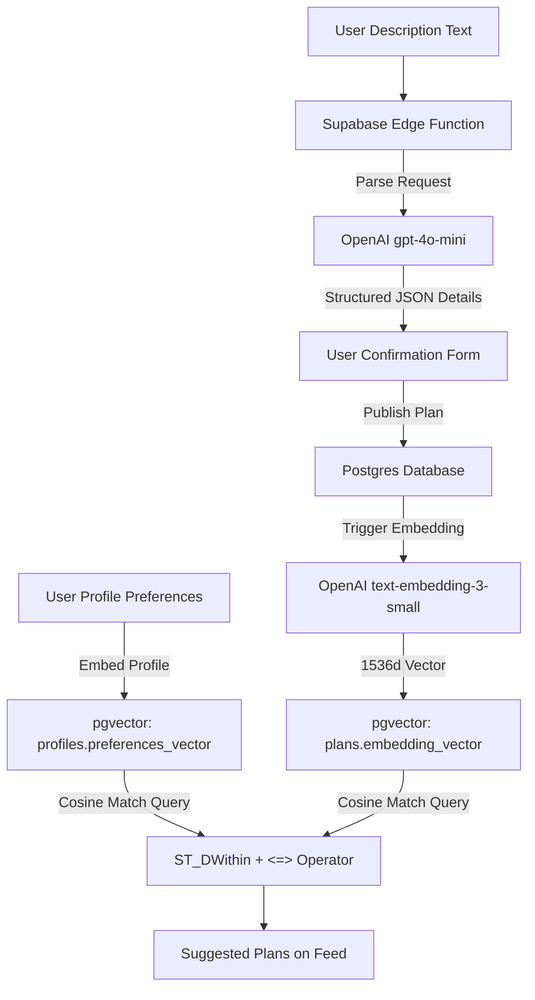
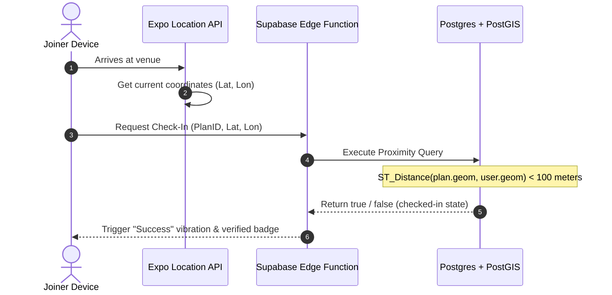

# Along - Tech Stack Deep-Dive Research

This document provides a detailed comparative analysis of different mobile-first framework combinations, backend architectures, geospatial databases, chat solutions, and AI & Maps search engine choices for Along.

---


## 1. Mobile Frameworks Comparison (Client)

| Feature / Metric | React Native (Expo Go) | Flutter (Dart) | Kotlin Multiplatform (KMP) |
| :--- | :--- | :--- | :--- |
| **Language & Learning Curve** | **JavaScript / TypeScript (Low)**: Reuses React skills. | **Dart (Medium)**: Object-oriented, separate ecosystem. | **Kotlin / Swift (High)**: Requires knowing native constructs. |
| **UI Performance** | **High**: Uses JSI (JavaScript Interface) and Fabric compiler. | **Ultra-High**: Direct Skia/Impeller hardware compilation. | **Maximum**: Compiles to 100% native UI widgets. |
| **Code Reuse** | High (can share models, hooks, and styles with Web Vite app). | Medium (cross-platform mobile, separate from standard web HTML). | Medium (shares logic; UI is usually written separately). |
| **OTA Updates** | **Yes (Expo Updates)**: Bypass store reviews. | No (requires complex third-party tools). | No (compiled binary updates only). |
| **Native APIs Access** | **Excellent (Expo SDK)**: Plug-and-play location, notifications. | Excellent (Flutter Plugins). | High (requires writing manual platform channels). |

---

## 2. Backend & Database Comparison

| Feature / Metric | Supabase (Postgres) | Firebase (Firestore) | Custom Server (Node.js/FastAPI + Postgres) |
| :--- | :--- | :--- | :--- |
| **Database Paradigm** | **Relational (PostgreSQL)**: Strong schema, easy joins. | **NoSQL Document Database**: Hard to join collections. | **Relational / NoSQL**: Flexible configuration. |
| **Geospatial Queries** | **Excellent (PostGIS)**: Runs native radius, distance checks. | **Poor**: No spatial indexes; requires client-side geohashing. | **Excellent (PostGIS)**: Full custom SQL queries. |
| **Real-time Capabilities** | **Yes**: Websockets synced to database table updates. | **Yes**: Firestore listeners. | **Yes**: Requires managing manual Socket.io servers. |
| **Authentication** | **Built-in**: Phone OTP, Google/Apple, Row-Level Security (RLS). | **Built-in**: Phone OTP, Google/Apple. | **Manual**: Must write JWT, session storage, and security logic. |
| **Hosting & Dev Ops** | **Serverless**: Zero configuration needed. | **Serverless**: Zero configuration needed. | **Self-Hosted**: Requires EC2/Heroku setup, SSL, backups. |

---

## 3. AI Pipeline & Semantic Matchmaking Architecture



### A. NLP Parsing Integration
* **Model**: `gpt-4o-mini`
* **Workflow**:
  1. The user inputs their plan draft.
  2. The frontend sends it to `/api/v1/plans/parse-nlp`.
  3. The endpoint instructs the LLM with a system prompt and a schema tool definition:
     ```json
     {
       "name": "extract_plan",
       "parameters": {
         "type": "object",
         "properties": {
           "title": { "type": "string" },
           "category": { "type": "string", "enum": ["sports", "running", "shopping", "yoga", "cycling", "hiking", "other"] },
           "datetime": { "type": "string" },
           "venue_name": { "type": "string" }
         },
         "required": ["title", "category", "datetime", "venue_name"]
       }
     }
     ```
  4. The returned structured properties populate the React Native details state immediately.

### B. pgvector Matchmaking Engine
Along represents user profiles and plans as vectors to suggest plans matching user interests:
* **Model**: OpenAI `text-embedding-3-small` (1536-dimensional vectors).
* **Database Storage**:
  ```sql
  ALTER TABLE plans ADD COLUMN embedding_vector vector(1536);
  ```
* **Similarity Query**: Similarity ranking uses the cosine distance operator `<=>` (where `0` is identical, `1` is orthogonal):
  ```sql
  SELECT id, title, category, (embedding_vector <=> $1) as distance
  FROM plans
  WHERE status = 'active'
  ORDER BY distance ASC
  LIMIT 5;
  ```

---

### C. AI Provider Comparison: OpenAI vs. Google Gemini

| Metric / Feature | OpenAI (Vetted Baseline) | Google Gemini (Alternative Option) | Decision Recommendation |
| :--- | :--- | :--- | :--- |
| **Primary NLP Model** | `gpt-4o-mini` | `gemini-1.5-flash` | Both are high-speed, cost-efficient models. |
| **NLP Pricing (Input/Output)** | $0.150 / $0.600 per 1M tokens | $0.075 / $0.300 per 1M tokens | **Gemini 1.5 Flash** is 50% cheaper, optimizing startup budgets. |
| **Average Latency** | ~350 - 450ms | ~250 - 350ms | **Gemini 1.5 Flash** is slightly faster for quick-parsing updates. |
| **Context Window** | 128,000 tokens | 1,000,000 tokens | **Gemini** handles massive history logs if doing bulk user recommendation summary. |
| **Structured Output Support** | JSON Schema Tool calling (100% rigid match) | Structured JSON output modes & Tool schemas | Parity. Both enforce strict JSON parsing formats. |
| **Embedding Model** | `text-embedding-3-small` | `text-embedding-004` | **OpenAI** outputs 1536d, **Google** outputs 768d. |
| **Embedding Cost** | $0.020 per 1M tokens | $0.025 per 1M tokens | Parity. Negligible cost difference. |
| **Vector DB Dimension** | **1536 Dimensions**: Higher precision for complex queries. | **768 Dimensions**: Lower database footprint and faster index checks in Postgres. | **768 Dimensions (Google)** is faster to execute under Supabase Postgres pgvector indexes. |

---

## 4. Maps & Search Autocomplete Engine

### A. Place Search Autocomplete & Map Picker (Google Places API v1 + Google Maps SDK)
We use the Google Places API (New) for location search input:
* **Session Tokens**: Every place autocomplete search uses a unique UUID session token. Keystroke inputs are compiled under a single session billing unit.
* **Geocoding**: Once the user selects a place from autocomplete, we request the details (Latitude, Longitude, and formatted address) using the Place ID.
* **Interactive Map Picker Verification**: To avoid formatting errors, the geocoded coordinate details are instantly loaded onto an interactive `<MapView>` component inside the creation form. The user can drag the red coordinates pin directly to align or confirm the exact meeting point.
* **Database Storage**: Coordinates are saved in Postgres using the PostGIS spatial type:
  ```sql
  ALTER TABLE plans ADD COLUMN geom geography(Point, 4326);
  -- Insert statement:
  INSERT INTO plans (geom) VALUES (ST_SetSRID(ST_MakePoint(longitude, latitude), 4326)::geography);
  ```

### B. Proximity Maps (React Native Maps + styled tiles)
* **Parity**: We enforce Google Maps SDK on both iOS and Android to prevent visual inconsistencies.
* **Privacy Proximity Mask**: The coordinates pinned on the Explore map use a randomized offset (200m radius circle) to mask the host's actual coordinates before acceptance.
  ```typescript
  // Simple proximity obfuscation for public maps views
  const randomOffset = () => (Math.random() - 0.5) * 0.003; // ~150-200m offset
  const displayLat = exactLat + randomOffset();
  const displayLng = exactLng + randomOffset();
  ```

---

## 5. Location Proximity & GPS Check-In Architecture



1. **Expo Location SDK**: Sets a background location task on the phone that wakes up when the user crosses a geofence (within 200m of the venue).
2. **Proximity Check**: Once within 100 meters, the app prompts a "Check-In" button.
3. **Database Assertion**: The server calculates the mathematical distance using PostGIS geography points to verify the user did not spoof their GPS coordinates on the client.

---

## 6. Gender-Restricted Visibility & Safety Boundary Assertions

To protect user safety and restrict reach based on host preferences:
* **Database Schema**:
  ```sql
  ALTER TABLE plans ADD COLUMN gender_reach VARCHAR(10) DEFAULT 'all' CHECK (gender_reach IN ('all', 'same'));
  ```
* **API Assertion Guardrails**:
  Before insert or query matching, edge functions evaluate visibility access:
  ```typescript
  // Validation during intent creation
  if (post.gender_reach === 'same') {
    // Assert host is same gender
    if (host.gender !== user.gender) {
      throw new Error("Security Violation: You can only restrict reach to your own gender.");
    }
  }
  ```
* **Feed Query Filtration**:
  ```sql
  SELECT * FROM plans
  WHERE (gender_reach = 'all')
     OR (gender_reach = 'same' AND host_gender = :viewer_gender);
  ```

---

## 7. Required External Services & API Integrations

To deploy Along in production, the engineering team must configure and provision the following third-party services and APIs:

| Category | External Service / Provider | Purpose / Integration Detail | Billing & Infrastructure Strategy |
| :--- | :--- | :--- | :--- |
| **Backend & Hosting** | **Supabase Cloud** (or AWS RDS PostgreSQL) | Core Relational DB, Edge Functions compute, Row-Level Security, real-time message broadcasting. | Pro Tier ($25/mo) for dedicated backups, connection pooling, and PostGIS usage limits. |
| **Mobile Compilation** | **Expo Application Services (EAS)** | Building native APK/IPA credentials, OTA (Over-the-Air) JS/TS bundle updates. | Free tier covers build queues; $29/mo priority queues as user volume scales. |
| **Geospatial & Maps** | **Google Cloud Platform (GCP)** | - **Places API (New)**: Location autocomplete search.<br>- **Geocoding API**: Coordinate conversion.<br>- **Maps SDK (iOS & Android)**: Visual maps. | Pay-as-you-go. Leverage UUID session tokens on autocomplete to bundle keystrokes into 1 billable item. |
| **Artificial Intelligence** | **OpenAI API** (or Vertex AI Gemini) | - `gpt-4o-mini`: Structuring unstructured user inputs.<br>- `text-embedding-3-small`: Generating interest match vectors. | Pay-as-you-go based on token usage. gpt-4o-mini is heavily subsidized (~$0.15 per million input tokens). |
| **Notifications Delivery** | **Apple Developer Program + Google Firebase** | Native APNS certificates for iOS and FCM configs for Android to trigger push warnings. | Apple: $99/year membership. Google Firebase: Free/Spark Tier. |
| **User Authentication** | **Twilio** (or Telesign) | OTP SMS carrier for secure phone number logins. | Pay-as-you-go per SMS dispatched (typically $0.007 to $0.05 per verification text). |
| **NSFW Content Safety** | **Sightengine** (or OpenAI Moderation API) | Text & media filtering to block vulgarity, offensive descriptions, or inappropriate profile pictures. | OpenAI Moderation API is free. Sightengine has standard pricing tiers for image audits. |
| **Asset Storage CDN** | **Supabase Storage** (or AWS S3) | Hosting uploaded user profile pictures, chat media uploads, and venue logos. | Free tier covers first 1GB; $0.021 per GB thereafter. |

---

## 8. Projected Monthly Cost Analysis (India-Based Startup)

This is a rough monthly projection for an early-stage production deployment, assuming a baseline of **1,000 - 5,000 Monthly Active Users (MAU)**. Pricing is optimized for a startup based in India.

| Service / Infrastructure | Estimated Usage | Projected Monthly Cost (USD) | Projected Monthly Cost (INR ~₹83/$) | Notes for India Market |
| :--- | :--- | :--- | :--- | :--- |
| **Backend (Supabase Pro)** | Dedicated instance, No Pausing | $25.00 | ₹2,075 | Essential for production stability, daily backups, and no cold-starts. |
| **OTP Auth (Twilio / MSG91)** | 2,000 verifications | $5.00 - $10.00 | ₹400 - ₹800 | **Cost-saving tip**: Use local Indian providers like MSG91 (₹0.15 - ₹0.20 per SMS) instead of Twilio ($0.05/SMS to India) to save up to 90% on auth costs. |
| **Geospatial & Maps (GCP)** | 10,000 sessions/loads | $0.00 (within free tier) | ₹0 | GCP provides a recurring $200/mo free credit, which covers ~11,000 Places Autocomplete sessions. |
| **AI (OpenAI gpt-4o-mini)** | 5M input / 1M output tokens | $1.35 | ₹115 | `gpt-4o-mini` is extremely cost-efficient for structing JSON plans and analyzing text. |
| **AI (Embeddings)** | 5M tokens | $0.10 | ₹8 | Negligible cost for generating vector embeddings. |
| **App Stores (Apple + Google)** | Annual fees amortized | ~$10.00 | ₹830 | Apple: $99/year. Google Play: $25 one-time (negligible monthly). |
| **CDN & Storage (AWS / Supabase)**| 10 GB media storage | $0.00 - $1.00 | ₹0 - ₹83 | Free tier handles initial load; very cheap thereafter. |
| **Total Estimated Run Rate** | **Baseline Startup Tier** | **~$40.00 - $45.00 / mo** | **~₹3,300 - ₹3,800 / mo** | Highly scalable and cost-effective tech stack for early product-market-fit phase. |

> [!TIP]
> **India Localization Note:** The biggest variable cost in India is OTP SMS verifications. Switching from Twilio/Firebase Auth SMS to an Indian aggregator (like MSG91, Textlocal, or Fast2SMS) for phone verification can drastically reduce authentication overhead.
